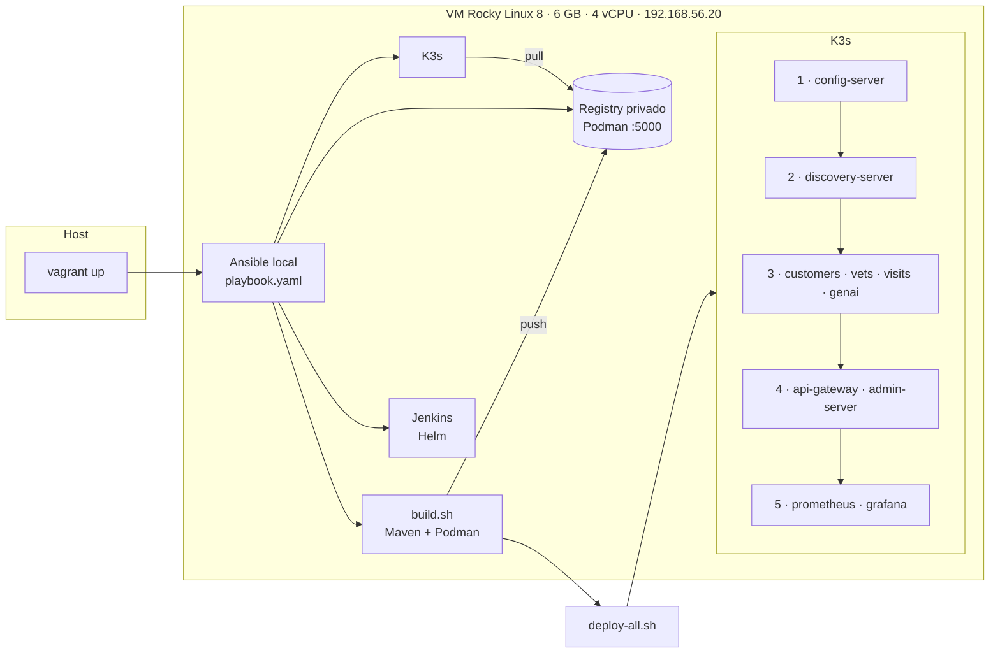

# 🐾 petclinic-k8s-automation

> De una máquina vacía a **10 microservicios en Kubernetes con monitorización**, con un solo comando: `vagrant up`.

Laboratorio de automatización de plataforma: aprovisiona una VM, instala **K3s**, monta un
**registry de imágenes privado**, compila y empaqueta
[Spring Petclinic Microservices](https://github.com/spring-petclinic/spring-petclinic-microservices)
y lo despliega por oleadas con **Prometheus + Grafana**. También instala **Jenkins con Helm**
como base del pipeline de la siguiente versión.

## Problema que resuelve

Una arquitectura de microservicios con Spring Cloud (Config Server, Eureka, API Gateway…) tiene
**dependencias de arranque**: si los servicios de negocio arrancan antes que la configuración y
el descubrimiento, fallan. Montarla a mano es lento y frágil. Este repo la convierte en un
proceso **reproducible y declarativo**: mismas versiones, mismo orden, mismo resultado.

## Arquitectura



## Requisitos

- **Vagrant** ≥ 2.3 y **VirtualBox**. Ansible **no** hace falta en el host: se ejecuta dentro de la VM.
- **12 GB de RAM** en el host (la VM usa 6 GB) y 4 núcleos.
- Plugin opcional: `vagrant plugin install vagrant-disksize` (disco de 40 GB).
- Conexión a internet: se descargan K3s, Helm, imágenes base y dependencias de Maven.

## Quickstart

```bash
git clone https://github.com/memecito/petclinic-k8s-automation.git
cd petclinic-k8s-automation
vagrant up            # la primera vez tarda bastante: compila 8 microservicios
```

Para seguir el arranque: `vagrant ssh` y `watch kubectl get pods`.
Para destruirlo todo: `vagrant destroy -f`.

## Acceso a los servicios

| Servicio | Cómo acceder | Notas |
|---|---|---|
| 🐾 Aplicación | http://192.168.56.20 | API Gateway expuesto con LoadBalancer (ServiceLB de K3s) |
| 📈 Grafana | http://192.168.56.20:3000 | Acceso anónimo como admin (ver Seguridad) |
| ⚙️ Jenkins | http://192.168.56.20:32195 | Usuario `admin`. La contraseña la genera el chart: `kubectl get secret jenkins -n devops-tools -o jsonpath='{.data.jenkins-admin-password}' \| base64 -d` |
| 🔬 Prometheus | `kubectl port-forward svc/prometheus 9090:9090` → http://localhost:9090 | Interno (ClusterIP) |
| 📡 Eureka | `kubectl port-forward svc/discovery-server 8761:8761` → http://localhost:8761 | Interno (ClusterIP) |

Los servicios Java tardan unos minutos en estar disponibles después del despliegue.

## Qué hace `vagrant up`, paso a paso

1. **Vagrant** crea la VM (Rocky Linux 8) e instala `ansible-core` y las colecciones necesarias.
2. **Ansible** ([`provisioning/playbook.yaml`](provisioning/playbook.yaml)):
   - actualizaciones de seguridad y puertos del firewall;
   - Podman y un **registry privado** de imágenes, configurados para que Podman y K3s lo usen;
   - **K3s** con versión fija (Traefik desactivado);
   - Java 17, **clonado de la app en un tag fijo** y compilación con Maven;
   - Helm y **Jenkins** con versión de chart fija.
3. **[`scripts/build.sh`](scripts/build.sh)**: construye una imagen por microservicio (y las de
   Prometheus y Grafana), las sube al registry y limpia las imágenes locales para ahorrar disco.
4. **[`scripts/deploy-all.sh`](scripts/deploy-all.sh)**: genera los manifiestos desde
   [`k8s-template.yaml`](scripts/k8s-template.yaml) con `envsubst` y los aplica **por oleadas**,
   respetando las dependencias de arranque.

## Decisiones de diseño

- **Registry privado en lugar de importar imágenes en el nodo.** Construyo con Podman y K3s
  ejecuta con containerd, que tiene su propio almacén de imágenes. Al principio importaba las
  imágenes a mano y fallaba: Podman las etiqueta como `localhost/…`, y con el tag `:latest` el
  kubelet intenta descargarlas siempre. Con un registry, el nombre de la imagen es el mismo en
  el build, el push y el manifiesto, y **el clúster descarga lo que necesita**, como en
  producción (modelo *pull*). Además funcionaría igual con varios nodos.
- **Versiones fijas en todo:** K3s, Helm, chart de Jenkins, imagen del registry y **tag del
  código de la app (`v3.4.1`)**. Empecé usando `:latest` y lo cambié: las versiones fijas hacen
  el despliegue reproducible y permiten volver atrás.
- **Despliegue por oleadas:** config-server → discovery-server → servicios de negocio →
  gateway → monitorización. Evita los fallos de arranque por dependencias de Spring Cloud.
- **Los nombres de los Services coinciden con los hostnames que espera Spring Cloud**
  (`config-server`, `discovery-server`…), así que el perfil `docker` de la app funciona en
  Kubernetes sin cambiar su configuración.
- **`ansible_local`:** el host solo necesita Vagrant y VirtualBox.

## Seguridad

Es un **laboratorio local**: algunas decisiones son conscientemente inseguras para simplificar.
Están identificadas, junto con lo que haría en un entorno real:

| En este laboratorio | En producción |
|---|---|
| Registry por **HTTP y sin autenticación** | TLS, autenticación, escaneo de vulnerabilidades al hacer push (Trivy) e imágenes referenciadas por *digest* |
| Grafana con **acceso anónimo como admin** (configuración de desarrollo del proyecto original), en la red privada de la VM | SSO / usuarios con roles; nunca admin anónimo |
| Credenciales de Jenkins en un Secret generado por el chart | Igual, más un gestor de secretos (Vault, External Secrets) |
| El servicio `genai` arranca con la clave `demo` y el chatbot no responde | La API key, en un Secret de Kubernetes, **nunca** en el repo |

Y lo que **sí** está cuidado:
- el kubeconfig con permisos `0600`;
- sin contraseñas en el código;
- solo actualizaciones de seguridad del sistema;
- versiones fijas.

## Qué haría distinto (y es la hoja de ruta de la v2)

- **Sondas `readinessProbe`/`livenessProbe` y `kubectl rollout status`** en lugar de los `sleep`
  entre oleadas: hoy el orden se garantiza esperando un tiempo fijo, no comprobando que el
  servicio esté listo.
- **Un chart de Helm** para todos los servicios en lugar de `envsubst` (empezado en
  [`chart-folder/`](chart-folder), solo para el gateway).
- **Pipeline CI/CD con Jenkins** (en curso en [`jenkins/`](jenkins)) y despliegue **GitOps** con
  Argo CD.
- **CI en este repo:** `shellcheck`, `ansible-lint`, `kubeconform` y `gitleaks` en cada PR.

## Problemas conocidos

Consulta la [guía de solución de problemas](common-mistake.md): errores de VirtualBox con Secure
Boot, "server gave HTTP response to HTTPS client", falta de memoria en la VM, etc.
